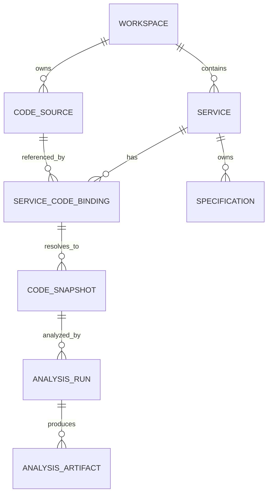

# 服务代码绑定设计

状态：v0.1.0 后续实现的第一版代码来源与服务绑定基础。

## 目标

服务是工作区中的逻辑业务对象。代码仓库、文件系统和服务之间不是一对一关系：
一个仓库可以包含多个服务，一个服务也可以由多个目录或文件组成。因此服务不直接
保存仓库 URL、语言或本地路径，而是通过独立的代码来源和绑定关系描述代码实体。



## 三层模型

### CodeSource：代码从哪里来

`CodeSource` 是工作区可复用的来源描述，不代表某个服务。第一版支持 `git` 和
`local_filesystem` 两种结构类型，`provider` 使用稳定字符串扩展到 GitHub、GitLab、
Generic Git 或其他代码托管平台。

```text
CodeSource
- id, tenantId, workspaceId
- sourceType: git | local_filesystem
- provider: github | gitlab | generic_git | local
- displayName
- canonicalKey             # 外部稳定身份，不依赖展示名称
- rootLocator              # 仓库 URL 或本地根位置描述
- executionScope: server | desktop_host
- archived, createdAt, updatedAt
```

凭据不放在来源或服务中。Git 来源只引用未来的 integration/secret ref；本地来源的
绝对路径属于宿主机边界，服务端不能把它当作可以跨机器访问的共享路径。

### ServiceCodeBinding：服务对应代码中的哪一部分

绑定是服务与代码来源之间的显式关系，允许同一来源绑定多个服务，也允许一个服务有
多个代码位置。

```text
ServiceCodeBinding
- id, tenantId, workspaceId
- serviceId, sourceId
- role: primary | additional
- entityKind: repository_root | directory | file | pattern
- path                    # 相对于来源根目录的 POSIX 路径
- revisionKind: default_branch | branch | tag | commit | working_tree
- revision                # 分支、Tag 或 Commit 值
- createdAt, updatedAt
```

路径不能依赖名称匹配；仓库根目录使用空路径，目录和文件使用相对路径，路径不能
包含 `..` 穿越。第一版一个服务最多一个 `primary` 绑定，但允许任意数量的
`additional` 绑定。相同服务、来源和实体路径不能重复绑定。

### CodeSnapshot：分析使用的不可变版本

绑定可以指向会变化的分支或本地工作树。代码分析、CI 和规范上传必须先解析出
不可变的快照，再以快照作为来源证据：

```text
CodeSnapshot
- id, bindingId
- resolvedRevision       # Commit SHA 或 working-tree fingerprint
- path, manifestHash
- resolvedAt
```

第一版只落地来源和绑定管理；快照、分析运行和产物在此稳定关系上增加，不把分析器
或代码抓取逻辑放入 Core。

## 语言、CI 与规范来源

语言和框架属于代码快照的分析事实，可以是多值并随代码版本变化，不在 `Service` 上
增加单一 `language` 字段。CI 通过独立的 `PipelineBinding` 关联服务和来源；规范仍归属
服务，通过 `SpecificationOrigin` 记录它来自绑定、快照、上传还是人工编辑。

CI 上传规范时应携带 `serviceId`、`bindingId`、`snapshotId`、来源路径和内容摘要，
服务端按现有权限、幂等和 ETag 规则处理。自动产物可以先作为分析 Artifact 保存，
再由明确的导入操作更新规范，避免流水线悄悄覆盖人工内容。

## API 边界

```text
GET    /code-sources
POST   /code-sources
PUT    /code-sources/{sourceId}
DELETE /code-sources/{sourceId}

GET    /services/{serviceId}/code-bindings
POST   /services/{serviceId}/code-bindings
PUT    /code-bindings/{bindingId}
DELETE /code-bindings/{bindingId}
```

服务创建接口继续只创建逻辑服务。目录 Catalog 只携带轻量绑定摘要，完整来源和绑定
通过独立资源读取，避免工作区加载被仓库元数据放大。所有写入都按租户、工作区和
服务范围校验，并沿用 Idempotency-Key、强 ETag、审计事件和 v1 错误 envelope。

## 分层决策

- `specx-types` 保存跨边界的来源、定位器、版本选择器和绑定事实。
- `specx-core` 保存范围、路径、重复绑定、主绑定和来源删除约束，并负责持久化。
- `specx-api` 保存 DTO、路由、授权、ETag、幂等和 OpenAPI。
- Provider/Host 未来负责 GitHub、GitLab、Generic Git 和本地文件读取；Core 不 clone
  仓库、不读取文件、不保存凭据。
- Vue/Pinia 只管理来源/绑定界面状态，通过统一 API transport 调用 Web 和 Tauri。

这样可以在不修改 `Service` 身份的情况下增加代码分析、CI 触发、规范上传、快照和
更多来源类型。
