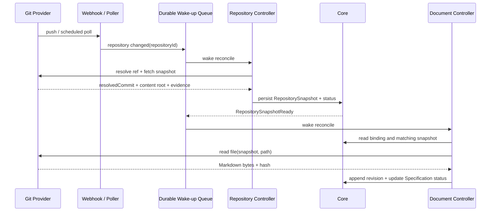

# SpecX 控制器与同步链路

状态：仓库快照交接第一版已完成。`specx-controller` 已提供通用运行时、事件路由、有限重试、平台文件 ContentStore、Git Provider 和 Markdown Document Controller；API 手动同步会生成并持久化去重的 `RepositorySnapshot`，返回 resolved commit、manifest hash、Provider 版本和快照 ID。持久任务队列、Webhook/Poller 自动唤醒和快照内容根的长期托管仍属于下一阶段。

本文把“控制器”定义为连接资源事实与外部能力的协调组件。控制器负责观察资源、调用能力、写回状态和产生不可变快照；Provider 只负责一次外部操作或外部观察，不拥有 SpecX 资源，也不直接写 Core 数据库。

## 1. 为什么采用控制器

SpecX 后续会同时处理仓库、规范、资产、分析和通知。把每条链路写成 API handler 或让某个 Provider 直接调用另一个 Provider，会导致领域知识向基础设施泄漏，也无法在 webhook 丢失、轮询重复、任务重试和进程重启后恢复。

控制器模型提供四个稳定性质：

- 用户修改的是资源的期望配置，控制器负责把它变成实际状态。
- 外部系统的变化先形成可追溯的快照，再由下游控制器消费。
- 事件只负责唤醒协调，控制器始终可以通过重新读取资源和状态自行恢复。
- 每个控制器只理解自己负责的资源和能力契约，不通过类型判断下游业务。

控制器不是必须常驻的集群组件。第一阶段可以由 Web Host 内的受控任务执行器承载；只要输入、输出、幂等和状态语义稳定，未来再拆成独立 Worker。

## 2. 三层职责

```text
Core 资源事实层
  保存资源身份、期望配置、状态、关系、审计和不可变快照元数据

Controller 控制器层
  观察资源和事件，选择能力，执行 reconcile，写回状态和快照

Provider 能力层
  访问 Git、Webhook、对象存储或分析引擎，返回结构化结果和证据
```

### Core

Core 不拉取 Git、不解析 Markdown，也不依赖某个 Provider。它提供带授权、并发控制和事务边界的命令，例如创建 RepositorySnapshot、追加 SpecificationRevision、更新资源 Status 和记录审计事件。控制器必须通过这些命令写入 Core，不能绕过 API 或直接连接数据库。

### Controller

控制器拥有一个资源类型或一个明确的资源关系边界。它从资源 `spec`、关联对象和上一次 `status` 得到输入，调用一个或多个 Provider，然后写回结构化状态。控制器可以产生任务和事件，但不能改变不属于自己的资源身份、权限或用户意图。

### Provider

Provider 是可替换的外部能力实现，例如 Git fetch、ref 解析、文件读取、Webhook 注册或 Markdown 语法校验。Provider 不知道“某个 Markdown 文件属于哪个 Specification”，也不能直接触发特定领域控制器；它只返回能力协议规定的结果。

## 3. 控制器契约

每个控制器至少声明：

```text
controllerId
watchedKinds             # 观察的资源类型或关系
triggerKinds             # 创建/修改/状态事件
capabilities             # 调用的 Provider 能力
statusOwner              # 可以写入的 status 字段
idempotencyKey           # 任务去重和重复执行规则
retryPolicy              # 超时、退避和不可恢复错误
```

一次 reconcile 应遵守以下顺序：

1. 读取资源、关联关系和当前 generation，重新执行授权检查。
2. 判断是否已经有匹配的成功状态或不可变快照；相同输入不得重复产生不同事实。
3. 调用 Provider，限制超时、网络出口、Secret 引用和资源用量。
4. 校验 Provider 返回的版本、hash、路径和证据，再通过 Core 命令提交结果。
5. 只有写回成功后才确认任务完成；旧 generation 的结果不得覆盖新意图。

控制器使用至少一次投递语义。事件重复是正常情况，事件丢失也不能阻止恢复：队列负责唤醒，周期性 reconcile 负责兜底。状态更新、快照创建和内容修订必须使用幂等键或唯一约束去重。

## 4. 仓库同步控制器（目标边界）

### 4.1 资源边界

仓库同步控制器只处理通用仓库和版本，不处理 Markdown、OpenAPI 或服务业务语义。建议的目标事实如下：

```text
Repository
- canonicalUrl, provider, integrationRef
- 用户登记的远程仓库身份

RepositoryTrack（可作为资源拥有的内部同步意图）
- repositoryId
- refKind: branch | tag | commit
- refName
- trackingMode: follow | pin
- ownerRefs / consumers

RepositorySnapshot
- repositoryId, trackId
- resolvedCommit
- sourceRef
- contentRootRef
- manifestHash, fetchedAt, providerVersion
- 不可变的仓库版本证据
```

当前 `SpecificationCodeBinding` 已经保存 `repository + path + ref`。后续可以通过内部投影把其中的 `repository + ref` 去重为 `RepositoryTrack`，而不要求仓库控制器读取 `path` 或知道 Specification。是否把 Track 物理化为独立表，应等第二个仓库消费者出现后再决定；第一版可以使用 Core 查询和唯一约束实现相同语义。

Branch 是可变跟踪目标，应在 webhook 或轮询触发后重新解析并生成新的 Snapshot。Tag 和 commit 通常是不可变目标，首次解析成功后不需要高频轮询；手动重新验证仍可执行。任何情况下，后续控制器都只消费 `resolvedCommit` 和 Snapshot，不把 branch 名称当作不可变事实。

### 4.2 触发和协调



Webhook 和 Poller 都只是触发器。Webhook 可能重复、延迟或丢失，不能被视为事实来源；Poller 也不能直接更新规范。两者都写入同一队列，最终由 Repository Controller 重新读取仓库资源和 ref 进行判断。

Provider 不一定需要把完整仓库复制进 SpecX。它可以返回带 `contentRootRef` 的快照，并提供受控的 `readFile(snapshot, relativePath)` 能力。平台内部的内容存储负责保存快照或内容对象，Core 只保存引用、hash、大小、媒体类型、生命周期和恢复所需元数据。

## 5. Markdown 文档同步控制器

第一版已经提供一个受 API 调用的同步适配器：它读取 `SpecificationCodeBinding` 的仓库 URL、ref 和 Markdown 路径，通过内置 Git Provider 获取文件，解析提交和 tree manifest，规范化换行并计算 `sha256:` 内容摘要，再以 Core 的 ETag CAS 写入规范正文和修订。`POST /specifications/{specificationId}/sync` 返回解析出的 commit、manifest hash、内容摘要、Provider 版本、同步时间和 `snapshotId`；重复内容不会追加修订，仓库/来源/提交相同的快照也不会重复创建。

该适配器是目标快照链路的可替换实现，暂时由 API 的受控同步调用承载。当前 `RepositorySnapshot` 已持久化提交、manifest、Provider 和时间证据，但内容根仍由 Provider 临时 checkout 管理；持久内容对象、Webhook/Poller 或跨进程任务恢复接入后，接口输入应切换为上游快照，控制器主体和 Core 写回语义保持不变。

Markdown 控制器处理“仓库快照中的某个路径如何成为 SpecX 规范内容”，不负责发现仓库、解析 branch 或注册 webhook。

输入是：

- `SpecificationCodeBinding`：Specification、ServiceRepository、Markdown 相对路径和 ref 选择器。
- 与该 `repository + ref` 匹配的最新 `RepositorySnapshot`。
- 文档同步策略，例如缺失文件、非法 Markdown、删除和历史保留方式。

协调步骤是：

1. 根据 binding 的 ref 选择最新且有效的 Snapshot。
2. 使用受控 `readFile` 能力读取相对路径；路径必须在仓库快照根目录内，不能穿越或访问任意主机文件。
3. 校验文件存在、大小上限、编码和 Markdown 内容，计算内容 hash。
4. 如果 hash 与当前规范相同，只更新观察状态，不追加重复修订。
5. 如果 hash 变化，通过 Core 追加 `SpecificationRevision`，更新内容引用和来源状态。
6. 写入 `resolvedCommit`、content hash、同步时间、Provider 版本和诊断条件。

仓库托管规范由控制器维护内容，因此 UI 继续保持只读。用户改变路径或 ref 时，是改变绑定的期望配置并触发新一轮协调；用户不能通过编辑器绕过来源控制。仓库文件删除、路径失效或权限丢失应进入明确的 `NotFound`、`AccessDenied` 或 `Degraded` 条件，并保留上一次成功内容，不能把规范静默清空。

Markdown 控制器通过观察 SnapshotReady 事件被唤醒，但不接受 Repository Controller 的直接函数调用。这样未来增加 OpenAPI、AsyncAPI 或代码分析控制器时，只需观察同一类仓库快照，不需要修改仓库控制器。

## 6. 平台内容存储

存储后端是平台实现细节，不是普通用户需要选择的资源。SpecX 应提供内部 `ContentStore` 能力，由部署方式、内容类型、大小和生命周期策略统一决定使用 SQLite 内嵌内容、文件系统、对象存储或未来的其他后端。

Core 及控制器永远只依赖内容引用：

```text
ContentRef
- storeKind（平台内部，不作为用户配置）
- objectKey
- mediaType
- byteLength
- contentHash
- createdAt / retention
```

用户不需要创建 StorageClass、StorageClaim 或 StorageBinding。平台管理员可以通过部署配置选择默认存储策略，但该选择不进入 Service、Specification 或业务 API 的普通 `spec`。缓存可以被清理和重建；规范正文、仓库快照和分析产物是否保留，由平台生命周期策略和资源引用决定。

外部 Git 凭据是另一类问题。它们不属于内容存储，也不应进入 Repository 或普通 Specification 配置；需要私有仓库时，由管理员配置 `Integration/Secret`，控制器向 Provider 传递短生命周期、最小权限的引用。若当前部署只支持公开仓库，则不提前实现完整 Secret 资源。

## 7. 一致性、失败和恢复

- RepositorySnapshot 是仓库控制器和下游控制器之间的稳定交接点；事件只是唤醒信号。
- 每个 Snapshot 以 `repositoryId + resolvedCommit` 去重；同一内容 hash 不重复生成规范修订。
- 控制器写入前检查 resource generation 和 binding 版本，避免旧任务覆盖新路径或 ref。
- 外部读取失败时保留最近一次成功 Snapshot 和规范内容，状态进入可重试条件。
- Provider 超时、Webhook 丢失、队列重复和进程重启都通过周期性 reconcile 恢复。
- 删除和解除来源遵循当前来源保护规则；存在仓库托管规范时，不能通过普通关系删除使其失去来源。
- 所有同步结果记录来源 URL、ref、resolvedCommit、hash、Provider 版本、执行主体和时间，支持审计和问题复现。

## 8. 落地顺序

1. 先把现有 `Repository`、`SpecificationCodeBinding` 和 `SpecificationRevision` 的状态、hash、resolved commit 语义补齐，保持现有 API 和只读约束。
2. 将当前手动同步适配器升级为内置 Repository Controller 的一次性 reconcile：公开仓库 fetch、ref 解析、快照元数据和受控文件读取。
3. 增加统一任务/事件队列，先支持手动触发和轮询，再接 webhook；两种触发方式复用同一 reconcile。
4. 让 Markdown Document Controller 只消费 RepositorySnapshot 和 binding，不把 Markdown 逻辑放进仓库控制器；现有手动同步入口保留为同一 reconcile 的调试和补偿入口。
5. 引入平台内部 ContentStore 适配器和垃圾回收策略；只有出现实际第二后端时才拆分对象存储实现。
6. 在出现第二个真实消费者后，再评估 RepositoryTrack 的物理资源化、通用 Controller Runtime 和外部 Worker。

## 9. 验收问题

每个新增控制器必须回答：

1. 它观察哪些资源，拥有哪部分状态，是否能在事件丢失后自行恢复？
2. 输入是声明意图还是上游不可变快照？重复输入如何幂等？
3. 使用哪些 Provider 能力，凭据和网络权限如何限制？
4. 失败时保留什么上一次成功事实，用户看到什么条件和可重试动作？
5. 它是否直接依赖下游领域，还是只通过资源和事件组合？
6. SQLite/PostgreSQL、审计、错误契约、迁移和 UI 状态展示如何保持一致？

