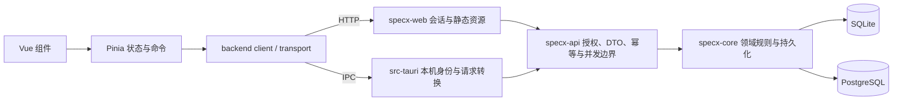

# 应用基础基线

基础范围核验日期：2026-11-04。`v0.0.1` 是首个正式桌面版本。

本基线用于开始业务开发，固定通用应用壳、分层边界、依赖锁文件和验证方式。
它记录 SpecX 当前实现，不代表所有目标业务已经完成。后续业务以此范围为
回归起点；基础能力按实际问题持续修复。

## 基线范围

- Vue 3 + Pinia 共用前端，Web HTTP 与 Tauri IPC 两种传输。
- 通用 UI、布局、主题、字体、目录交互、面板状态及品牌资源。
- 简体中文/英文资源、类型约束、语言持久化与新增文案规范。
- 统一的延迟文字提示、三态主题切换、可搜索/编辑/停用/重置的快捷键。
- 分组/服务创建的即时反馈、幂等重试、失败草稿恢复与工作区隔离。
- Rust 共享类型、纯格式工具、平台配置、领域与持久化、API、Web Host 和桌面壳。
- SQLite/PostgreSQL 适配、授权、审计、ETag、修订、备份相关现有实现与测试。
- Docker 构建与部署配置、CI、锁文件、迁移来源和开发规范。

`refs/`、本机配置、数据库、截图、测试运行产物和 Tauri 自动生成的权限 schema
不进入提交；字体和应用图标作为源码资源保留。两个 Rust 工程的锁文件和 pnpm
锁文件一并提交。

## 前后端调用与状态归属

| 代码位置 | 当前职责 | 业务开发约束 |
| --- | --- | --- |
| `components/ui`、`composables`、`styles` | 通用交互、视觉与窗口内状态 | 不放领域规则，不复制主题、提示和快捷键机制 |
| `stores`、`lib/sidebar`、`lib/transfer` | 资源命令、页面状态及目录/导入适配 | 共享事实经 API；当前创建队列只覆盖分组/服务，不是所有资源的离线同步器 |
| `lib/backend`、`types/api.ts` | 传输适配、API 请求与响应 | HTTP/IPC 复用同一业务契约，新增响应字段与后端 DTO 对齐 |
| `specx-types`、`specx-formats`、`specx-platform` | 共享事实、纯内容工具、主机配置 | 不引入 UI、HTTP 或特定业务 Provider |
| `core` | 领域不变量、SQLite/PostgreSQL 持久化 | 保留租户/工作区隔离、事务和内容修订语义 |
| `specx-api` | 资源路由、DTO、授权和存储门面 | 保留幂等、ETag、角色校验和审计；按具体资源增长再拆模块 |
| `specx-web`、`src-tauri` | 会话/本机身份、进程生命周期及传输 | 两个 Host 调用同一 API router，不复制业务实现 |

主题、字体、语言、快捷键、目录展开和标签页属于当前设备偏好。
服务、分组、标签、规范及修订是服务器共享事实。待保存名称属于临时本机草稿，
不得假装为已经确认的服务器事实。

详细入口见 [代码导览](../guides/understanding-specx.md)、
[代码规范](code-conventions.md)、
[crate 边界](../../crates/ARCHITECTURE.md)、[API 契约](api-contract.md)、
[国际化规范](i18n.md) 和[前端开发说明](../../apps/desktop/README.md)。
通用界面能力的职责见 [UI 基础层](ui-foundation.md)。

## 业务能力现状与接入顺序

业务主线是 `Tenant → Workspace → ServiceGroup → Service → Specification`，
Tag 与 SpecificationRevision 分别提供横向分类和历史。

| 能力 | 后端现状 | 前端现状 |
| --- | --- | --- |
| 分组与服务目录 | 创建、修改、移动、删除、筛选及服务归档接口已有 | 目录创建、改名、移动、筛选、定位与服务概览已有；归档/完整详情编辑尚未形成界面闭环 |
| Markdown 规范 | 创建、修改、删除、ETag、修订列表/读取/恢复已有 | 创建与预览已有；编辑、未保存退出处理、冲突与修订恢复尚未接线 |
| 工作区、成员和邀请 | 角色、成员管理、邀请与访问上下文已有 | 工作区切换已有；完整工作区/成员管理尚未接线 |
| 标签与备份 | 资源与授权接口已有 | 标签筛选与目录导入导出已有；标签管理和服务端备份界面尚未接线 |

建议第一条业务纵向闭环为“规范编辑与修订”：从现有创建和预览进入编辑，
携带 ETag 保存，保存失败保留草稿，并发冲突提供明确处理路径，读取历史和
恢复版本后刷新当前内容。先定义业务场景、状态与验收，再贯通现有 API、Core
与界面；这里记录的是后续设计入口，不表示本次已实现这些业务交互。

每条业务功能按以下顺序推进：

1. 描述角色、用户操作、成功/失败路径、权限与可验收结果。
2. 明确领域不变量、DTO、错误身份、幂等或 ETag，以及两种存储的影响。
3. 优先复用现有后端接口；缺失能力落在其负责层，再接前端命令和界面。
4. 按实际界面验证交互，覆盖失败恢复、跨工作区、并发、中英文与窄窗口。

## 基线后续：错误契约闭环

错误响应已在基线后升级为 v1 envelope，API、Web 登录、框架拒绝和 Tauri
请求失败共用同一 catalog。Core Debug 文本不再进入客户端响应，前端按
`messageKey/messageParams` 本地化并保留机器身份。详情和新增错误要求见
[错误契约](api-error-contract.md)与[API 契约](api-contract.md)。

## 验证与发布边界

共享应用壳、Web 部署、Tauri 桥接与发布验证的范围和限制见
[基础能力验收记录](../production-initial-execution.md)。持续集成结果以当前提交的
Actions 检查为准。

补充使用隔离的 PostgreSQL 17 容器，实际验证迁移并发、事务回滚、工作区隔离、
会话、邀请清理、备份控制流程以及 API 成员授权和规范 ETag 并发控制。测试库
及容器已清理；未提供客户端轮换证书，TLS 握手/证书轮换分支没有执行。
备份控制流程使用测试替身，不等同于生产 `pg_dump`/`pg_restore` 全流程验收。

运行与 CI 的 Rust 最低版本统一为 1.90：当前锁定的 `uuid 1.29.0` 要求 Rust
至少 1.89，原文档和 CI 的 1.88 与锁文件不一致；1.90 是本轮实际验证的版本。
Docker 的 Node 22 构建也验证了前端不依赖本机较新的 Node 运行时。

镜像 `specx:foundation-baseline` 构建成功。临时容器验证了登录、
分组/服务/规范写入、服务 ETag、快捷键页面及重启后的数据与会话持久化；
容器所服务的主 JS 与本地构建逐字节相同。临时容器和测试数据已清理，结果与
截图保存在本地忽略目录 `outputs/foundation-baseline/`。

PostgreSQL 相关测试必须指向隔离测试库，不能使用真实业务数据库；没有设置
`SPECX_TEST_POSTGRES_URL` 时，现有集成测试会提前返回，不能将控制台的通过数
当作实库已验证。TLS 握手及客户端证书轮换还依赖独立的证书测试环境。

以下事项不阻止进入业务开发，但必须保留并在相应发布范围内完成：

- 各系统上的 Tauri 原生窗口、安装包与系统集成仍需实机验收，桥接测试不能
  代替这些检查。
- PostgreSQL TLS/证书轮换、真实备份恢复工具链与目标生产环境需单独验收。
- 当前前端主包约 537kB，有 Vite 体积提示；随业务页面增长安排按需加载，
  不用提高阈值来掩盖体积增长。
- 大文档、附件、外部仓库采集、插件和 AI 等未定业务继续按独立 Story 设计，
  不提前建立空框架或宣称已完成。

本机 vfox 的 `rustfmt` 需要能找到同版本 Rust 动态库；本轮用临时
`LD_LIBRARY_PATH` 指向该工具链的 `rustc/lib` 完成格式检查，未修改项目源码
或用户全局环境。标准 Rust 安装与 CI 不需要该本机修正。
