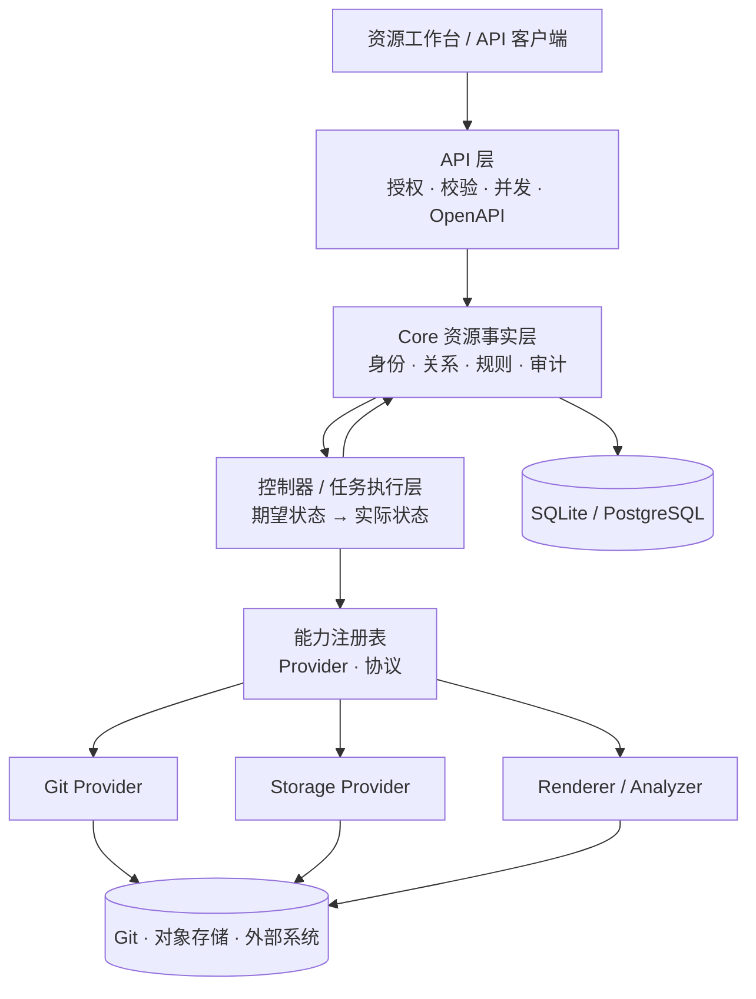

# SpecX 平台资源与能力设计总纲

状态：目标架构草案，供后续 Story、领域模型和 API 评审使用。

本文定义 SpecX 的长期建模方向。它借鉴 Kubernetes 的资源、声明式配置、标签选择器和插件思想，但不把 Kubernetes 的全部控制面、调度器或 YAML 接口照搬进来。本文中标记为“目标”或“后续”的内容不代表当前已经实现；可执行行为仍以代码、OpenAPI 和迁移为准。

当前已落地通用基础：`specx-types` 提供资源引用、状态、条件、事件和内容引用契约，`specx-controller` 提供宿主内控制器运行时、事件按 Kind 分发、代际去重、有限重试、文件 ContentStore、Git Provider、Repository Controller 和 Markdown Document Controller。API 与 Web Host 已接入持久任务、租约恢复、分支轮询、签名 Webhook、快照文件发现、加密 Secret/Integration 和后台 worker；手动与自动同步共用不可变 RepositorySnapshot 交接。

## 1. 目标与边界

SpecX 的核心价值不是再做一个文档编辑器，而是为服务、规范、代码、运行环境和外部能力建立稳定的事实层。用户能够把不同类型的对象组合起来，用统一的查询、授权、审计和状态观察方式管理它们，再由可替换的能力实现完成同步、解析、存储和分析。

长期目标可以归纳为四点：

1. **统一资源语言**：服务、规范、仓库、资产、环境和未来的工作负载都具备稳定身份、明确范围、可查询元数据和可演进版本。
2. **声明意图与观察事实分离**：用户保存要达到的状态，系统异步执行能力并记录实际状态、条件和证据。
3. **能力可替换**：Git、对象存储、Markdown 渲染、搜索、分析、通知等能力通过版本化 Provider 接入，Core 不依赖某个厂商或执行环境。
4. **组合优先于特例**：关联、选择器、类和 Claim 用于组合资源；新增领域尽量增加资源和能力，不在 `Service` 上不断堆叠供应商字段。

以下边界必须保留：

- Tenant 和 Workspace 是授权与数据隔离边界，不是普通标签。
- Core 是业务事实、领域不变量、授权和审计的所有者；Host 负责会话、进程和传输；Provider 负责被声明的外部能力。
- 标签和选择器只能筛选资源，不能替代授权、外键或来源证据。
- 不为尚不存在的功能创建空的插件市场、调度器或通用数据库表；每一层都要有明确的消费者和可验证的契约。

## 2. 目标架构



读路径优先读取 Core 中的资源事实和最近一次观察状态。写路径先经过授权、Schema 校验、并发控制和审计，再写入期望状态；需要访问外部系统的操作由控制器执行，结果通过状态和不可变快照回写。Provider 不直接修改服务、规范、目录或权限表。控制器之间通过资源观察和持久事件协作，而不是通过领域特定的直接调用。详细约定见[控制器与同步链路](controller-model.md)。

## 3. 资源模型

### 3.1 资源信封

目标资源使用统一的逻辑信封。API 可以继续提供面向领域的专用路由，但每个路由都应能映射到同一套身份和生命周期语义。

```yaml
apiVersion: specx.io/v1alpha1
kind: Specification
metadata:
  id: 01J...
  name: payments-api
  workspace: 01J...
  labels:
    domain: payments
    maturity: stable
  annotations:
    specx.io/source: repository
spec:
  # 用户声明的目标配置，由具体资源定义
status:
  observedGeneration: 3
  phase: Ready
  conditions: []
```

字段语义如下：

- `apiVersion` 和 `kind` 标识可演进的资源契约；版本升级必须有兼容策略。
- `metadata.id` 是系统身份，永不因改名、移动目录或换来源而改变。
- `metadata.name` 只用于工作区内的人类识别；名称变更不得成为关联键。
- `metadata.labels` 是低基数、可筛选的键值；`metadata.annotations` 存放展示、来源和 Provider 扩展信息，不作为通用筛选条件。
- `spec` 是用户声明的配置或关联选择器。资源专属不变量由 Core 校验。
- `status` 是系统观察结果，不能由普通客户端伪造。状态写入需要来源和时间戳，并保留错误诊断的机器身份。

资源不必都以一张通用表保存。对权限、唯一性、修订和查询有要求的资源继续使用显式领域表；通用信封只统一身份和语义，不鼓励 EAV 或“所有字段都塞进 JSON”。

### 3.2 资源范围与命名

资源按作用域分为：

| 范围 | 示例 | 规则 |
| --- | --- | --- |
| Tenant | Workspace、成员、全局 Provider 安装 | 跨 Workspace 隔离；只有租户级授权可读写 |
| Workspace | Service、Repository、Tag、Specification | 当前产品的主要协作边界；资源引用必须带 Workspace |
| Resource-owned | Revision、CodeSnapshot、Task、Event | 由父资源拥有，不能脱离父资源授权访问 |
| Host-local | 主题、语言、面板标签页、窗口尺寸 | 不属于共享业务事实，不进入 Core 资源目录 |

`ResourceRef` 至少包含 `tenantId`、`workspaceId`、`kind` 和 `id`。跨资源关系必须保存来源、目标和关系类型；不能依赖名称、路径或标签推断身份。资源的删除、归档和恢复要遵循父子关系及来源约束。

### 3.3 当前资源到目标模型的映射

| 当前对象 | 目标资源角色 | 说明 |
| --- | --- | --- |
| `Service` | 治理资源 | 服务是规范、资产和代码分析的主要所有者，不内嵌供应商字段 |
| `ServiceGroup` | 目录资源 | 目录移动影响展示位置，不改变服务身份 |
| `Tag` / `ServiceTag` | 人工分类关系 | 继续支持颜色和管理；未来可投影为 label，但不能直接删除显式关系语义 |
| `Specification` | 内容资源 | `spec` 保存来源和编辑意图，内容修订是不可变子资源 |
| `Repository` | 代码来源资源 | 工作区内按规范化 URL 复用，不保存凭据 |
| `ServiceRepository` | 关系资源 | 表达服务与仓库的治理关系，一期一个服务最多一条 |
| `SpecificationCodeBinding` | 来源 Claim/关系资源 | 选择 Markdown 路径和 Git ref；绑定本身不代表已完成拉取或解析 |
| `SpecificationRevision` | 不可变快照 | 保存具体内容版本和证据，不能被覆盖 |
| `CodeSnapshot`（目标） | 观察快照 | 保存 resolved commit、manifest hash 和解析证据 |
| `Asset` / `SourceSpec`（目标） | 分析资源 | 以目录、glob 或其他选择器声明代码资产范围 |

现有 API 和数据库可以逐步增加资源元数据，不要求一次性把所有类型改成通用 CRUD。稳定的领域路由、ETag、错误 envelope 和 SQLite/PostgreSQL 对等性优先于表面统一。

## 4. 标签、选择器与关系

### 4.1 两类元数据

- **Labels**：用于列表筛选、集合选择和自动化触发，要求值短、稳定、可索引。示例：`team=payments`、`lifecycle=active`。
- **Annotations**：用于来源 URL、外部 ID、展示偏好、Provider 证据和迁移信息。它们可以变化，不承诺可高效筛选。

当前 `Tag` 仍是带颜色和显式关联的用户对象。迁移到 labels 前，需要解决颜色、重命名审计、权限和低基数约束；在此之前，标签筛选不能偷偷改写成字符串匹配。

### 4.2 选择器

一期选择器只需要支持明确可测试的子集：

```text
environment=production
team in (payments, billing)
!archived
```

选择器的使用场景包括资源列表、批量任务输入、Asset 文件范围和能力绑定。API 必须返回稳定排序、分页信息和选择器解析错误；选择器不能跨 Workspace，也不能绕过资源授权。高基数字段、任意正则和全文搜索不纳入第一版选择器语法。

### 4.3 关系资源优先

当一个对象的关系拥有独立生命周期、授权或状态时，使用显式关系资源，而不是在主体上增加越来越多字段：

- `ServiceRepository` 连接服务与仓库。
- `SpecificationCodeBinding` 连接规范、服务仓库和 Git ref。
- 目标中的 `CapabilityBinding` 只在某种能力确实需要独立选择和生命周期时引入；普通资源不暴露 Provider 选择。

关系资源必须有清晰的删除语义、并发版本和来源证据。一个关系被删除时，不能顺带删除仍被其他资源使用的目标对象。

## 5. 期望状态、实际状态与协调

### 5.1 状态模型

只要操作需要访问 Git、对象存储、网络或分析引擎，就不能把“请求已接受”伪装成“同步完成”。资源应区分：

- `spec`：用户或上层资源声明的目标。
- `status`：Provider 最近一次观察到的实际结果。
- `observedGeneration`：状态对应的资源版本。
- `conditions`：可组合的稳定条件，例如 `Ready`、`Syncing`、`Degraded`、`AccessDenied`。
- `lastError`：机器可识别的错误码、重试建议和时间；不暴露 Debug 文本或凭据。

状态更新必须幂等，并且可在重复任务、网络超时和 Provider 重启后恢复。同步成功应记录不可变证据，例如 resolved commit、内容 hash、Provider 版本和执行时间。

### 5.2 控制器边界

目标控制器负责把资源的期望状态交给正确的能力实现，并将结果写回 Core。它不拥有资源身份，也不绕过 API 授权。控制任务应具备：

- 由 `resourceVersion` 或 `generation` 触发，避免旧任务覆盖新意图。
- 幂等键和去重；同一资源的互斥或合并策略明确。
- 有界重试和退避；不可恢复错误进入 `Degraded`，等待用户修正。
- 可观察的任务记录、审计事件和取消语义。
- 在 Provider 不可用时保留已有内容和上一次成功状态。

第一阶段不需要常驻控制器集群。可以先由 API 创建任务、由 Host 内任务执行器完成，并为未来拆分为独立 Worker 保留同样的输入输出契约。仓库同步和 Markdown 文档同步的控制器分层、快照交接和失败恢复见[控制器与同步链路](controller-model.md)。

## 6. 能力、Provider 与平台服务

### 6.1 能力契约

能力是可被资源调用的动作或观察服务，不是某个具体厂商对象。每个能力至少声明：

```text
capabilityId       # 例如 source.git.fetch 或 content.markdown.render
protocolVersion
inputSchema / outputSchema
requiredPermissions
executionMode      # sync | task | watch
idempotency        # key 的组成和重复调用语义
sideEffects        # none | external-read | external-write
```

Markdown 渲染、Git ref 解析、仓库文件发现、对象存储读写、搜索索引和 webhook 接收都可以成为能力。Core 只依赖能力契约，不依赖 `GitHubRepository` 或某个云厂商的专属类型。

### 6.2 Provider

Provider 是能力的实现和运行边界。Provider 可以内置在 Rust Host 中，也可以在未来通过受管进程、HTTP 或任务队列运行。是否隔离取决于代码执行、网络访问、资源消耗和供应商可信度；不要为纯函数渲染器提前引入进程编排。

Provider 必须：

- 通过注册表声明能力、协议版本、支持的资源类型和健康状态。
- 接收最小授权上下文和显式 Secret 引用，不能读取任意租户数据。
- 返回结构化结果、证据和稳定错误码，不能直接写 Core 数据库。
- 支持超时、取消、重试和版本兼容；停用时保留资源和历史结果。

### 6.3 平台能力与内部绑定

Provider 的选择通常是平台内部决策，不是普通资源的用户配置。控制器根据资源类型、部署策略、能力协议和可用性选择 Provider，并在状态或审计中记录实际使用的 Provider 版本。只有当某种能力确实需要独立授权、生命周期或租户级策略时，才引入显式的 `CapabilityBinding`；不要为每个资源都增加 `Class/Claim/Binding` 三件套。

内容存储尤其应由平台统一定义。规范正文、附件、仓库快照、渲染缓存和分析产物都通过内部 `ContentStore` 写入，平台根据部署配置、内容大小、类型和生命周期选择 SQLite 内嵌内容、文件系统或对象存储。用户不创建 `StorageClass`、`StorageClaim` 或 `StorageBinding`，业务资源只保存 `ContentRef`、hash、大小、媒体类型和保留元数据。缓存可重建，Core 仍保存恢复所需的引用和不可变证据。

外部 Git 凭据与内容存储分开处理。私有仓库需要时，由管理员配置 `Integration/Secret`，控制器向 Git Provider 传递短生命周期、最小权限的引用；Repository 和 Specification 不保存连接串或明文凭据。当前部署没有真实的多后端或私有仓库消费者时，不提前建立面向用户的存储类和秘密管理界面。

未来出现真正的 Workload 后，可以为网络连接或其他外部运行能力定义类似 CNI 的 Provider 和内部绑定，但不应把网络插件接口提前套在当前服务目录或代码同步上。

## 7. 安全、授权与秘密

- 授权始终依据服务端会话、Tenant、Workspace、主体角色和资源关系；客户端提供的上下文头不能成为身份凭据。
- Labels、Annotations、选择器和外部 ID 都是不可信输入，必须经过长度、字符集和基数限制。
- Secret 不进入普通资源 `spec`、日志、审计摘要或前端缓存；资源只保存 Secret 引用和所需用途。
- Provider 调用使用最小权限、短生命周期凭据和可撤销的执行上下文。
- 外部同步和分析结果必须带来源、执行主体、Provider 版本、时间和不可变内容摘要，确保可以追溯和重放。
- 资源删除需要考虑关系资源和 finalizer。外部清理未完成时可以保留删除中的状态，不能立即释放仍会被异步任务使用的凭据或快照。

## 8. 持久化与 API 演进

### 8.1 持久化原则

SQLite 和 PostgreSQL 继续实现同一 Core 接口。资源模型演进遵循：

1. 身份、授权、唯一性、ETag、修订和关系使用显式列与约束。
2. Labels、Annotations、Spec 的扩展字段可在明确上限内使用 JSON，但常用筛选字段需要投影和索引。
3. 状态、任务、事件和快照追加写入；不得用最新 JSON 覆盖审计所需的历史。
4. 每次 Schema 变更同时更新两种适配器、迁移检查和 OpenAPI/错误契约。
5. 外部对象和缓存不是 Core 唯一事实；数据库中保留引用、hash、生命周期和恢复所需的元数据。

### 8.2 API 形态

现有专用路由继续作为一期稳定接口。目标 API 增加通用能力，但不以一个无类型的 `/resources` 端点取代所有领域路由：

```text
GET    /workspaces/{workspaceId}/resources?kind=Specification&labelSelector=team%3Dpayments
GET    /resources/{kind}/{id}
POST   /resources/{kind}
PATCH  /resources/{kind}/{id}
DELETE /resources/{kind}/{id}
GET    /resources/{kind}/{id}/events
POST   /resources/{kind}/{id}/reconcile
```

通用路由只允许注册表中已知的 Kind，并复用现有 v1 错误 envelope、ETag、分页、授权和审计规则。高风险动作（恢复、解除来源、删除外部对象）仍使用领域专用命令以表达更严格的业务不变量。

## 9. 用户体验方向

资源化不意味着第一天让用户填写 YAML。桌面端应先提供可理解的工作台：

- 资源目录支持按 Kind、标签、状态和所属服务筛选；查询结果显示稳定名称、状态条件和最近观察时间。
- 详情页将“配置”“关系”“状态”“事件”和“能力”分区；只读来源资源明确显示来源和受保护操作。
- 长时间操作显示任务进度、当前阶段、可重试错误和最后一次成功证据；不能只显示一个永久 loading。
- 能力和 Provider 不可用时，保留已有内容的阅读路径，并解释缺失能力和影响范围。
- 高级用户可以查看资源 JSON 或导出清单，但编辑入口仍使用类型化表单，避免把内部字段和 Secret 暴露给普通用户。
- 标签筛选、跨资源跳转和历史版本都应从资源 ID 出发，不依赖名称或当前面板缓存。

## 10. 分阶段落地路线

### Phase 0：冻结语言和边界

- 为现有 Service、Specification、Repository、关系资源补充稳定的 `kind`、ResourceRef、generation/ETag 语义。
- 记录现有 Tag 与未来 labels 的差异，暂不做破坏性迁移。
- 建立资源/能力目录和领域不变量清单；每个 Story 标注 owner、scope、写入者和状态来源。

### Phase 1：资源内核

- 增加统一 metadata、labels、annotations、conditions 的类型和校验器。
- 为列表接口增加受限 label selector、稳定分页和资源状态摘要。
- 增加事件/审计查询和 `observedGeneration`，不改变现有 Markdown、仓库绑定和错误契约。
- 继续使用显式领域表，不创建“万能资源表”。

### Phase 2：能力注册与控制器执行

- 把 Markdown 渲染、Git ref 校验/解析、代码文件发现抽象为版本化能力契约。
- 增加 Provider 注册表、健康状态、超时/取消和结构化诊断。
- 首先支持 Host 内置 Provider 和控制器任务，完成重试、幂等、审计和状态回写。

### Phase 3：平台内容存储与外部连接

- 建立平台内部 `ContentStore`，让规范正文、附件、代码快照和分析产物使用统一的内容引用。
- 把大内容、缓存和快照的物理存储从 Core 事务中解耦，同时保留 hash、引用、大小、生命周期和恢复元数据。
- 私有外部系统确有消费者时，建立管理员控制的 `Integration/Secret` 和最小权限 Provider 上下文；不把存储后端选择暴露给普通资源用户。

### Phase 4：控制器驱动的自动同步与分析闭环

- 将当前已接入 API 的 Git Provider/Markdown Document Controller 手动同步适配器升级为通用 Repository Controller：复用已有快照元数据契约，补齐 Git fetch、ref 解析、版本自动选择、webhook/轮询和持久任务恢复。
- 让 Markdown Document Controller 改为只消费仓库快照，按 binding 的路径读取并追加规范修订；控制器之间通过快照和持久事件交接。
- 引入 Asset/SourceSpec、代码快照和分析结果索引，让其他控制器复用同一仓库快照而不理解 Markdown。
- 用标签和选择器驱动批量协调、搜索索引和通知，但不让选择器绕过授权。

### Phase 5：受控扩展

- 评估外部 Provider 进程、插件包、协议兼容和资源配额。
- 只有出现第二个独立消费者且安全边界明确时，才开放 Custom Resource 或工作负载级调度能力。
- 对插件升级、撤销、数据迁移和回滚建立独立发布策略；不建立不可验证的任意代码市场。

## 11. 近期 Story 的验收标准

后续每个资源化 Story 至少应回答以下问题：

1. 资源的 `kind`、scope、稳定身份和 owner 是什么？
2. 哪些字段属于 `spec`，哪些属于 Provider 产生的 `status`？
3. 谁可以创建、读取、修改、删除和观察它？跨 Workspace 如何拒绝？
4. 是否需要显式关系资源、ETag、幂等键、修订或 finalizer？
5. 失败后已有内容和上一次成功状态如何保留？任务能否重试和取消？
6. SQLite、PostgreSQL、OpenAPI、错误目录、双语文案和迁移是否同步？
7. 当前 UI 如何让用户看到来源、状态、证据和受保护操作？
8. 该能力是否已经有真实消费者；如果没有，为什么现在需要建立抽象？

违反这些条件的设计，不应仅因为“看起来像 Kubernetes”就进入 Core。平台化的价值在于稳定边界和可组合行为，而不是资源数量或抽象层数量。

## 12. 待决策事项

以下事项在进入对应 Phase 前单独评审：

- labels 是否与现有 Tag 统一，还是长期保留“人工标签 + 机器标签”两种语义。
- 通用资源清单是否需要 YAML/JSON 导入导出，以及如何处理 Secret 引用和版本兼容。
- 任务队列使用 Core 内置执行器、独立 Worker，还是交由外部队列系统。
- ContentStore 的默认后端、垃圾回收和跨部署恢复策略。
- Provider 的隔离等级、网络出口、资源配额和管理员级 Integration/Secret 审批。
- 是否需要 Workload 资源；在没有部署、运行或分析任务的真实用户场景前，不提前把 Service 直接改名为 Workload。

