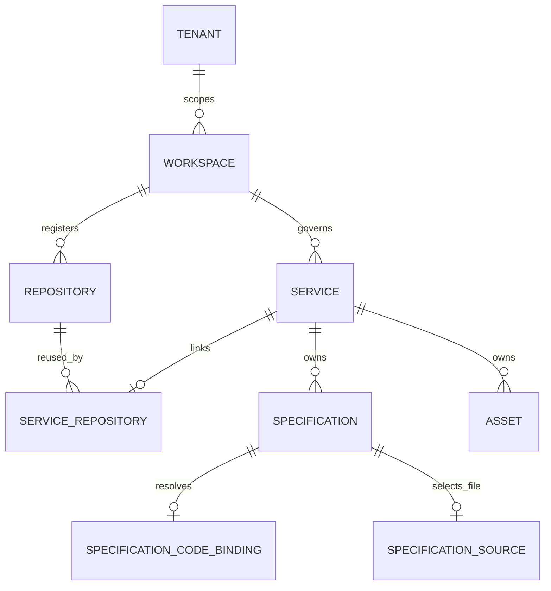

# 服务、仓库与代码资源管理

状态：一期模型、API 和桌面交互约定。模型围绕 Service 的治理边界构建，仓库登记与规范来源分开管理；文中标为“后续”的内容不属于当前已实现能力。

## 1. 一期结论

`Service` 是 SpecX 的最小治理和分析单元，承载规范、资产、负责人、生命周期和 API 权限。`Repository` 是可复用的 Git 仓库登记项，回答“代码来自哪里”。一期约束为：

- 一个 Service 可关联 0 或 1 个 Repository；一个 Repository 可被多个 Service 复用。
- Repository 只能从已有 HTTPS/SSH Git URL 登记，SpecX 不创建远程仓库、不 clone 代码。
- 用户只输入仓库 URL。Provider、仓库显示名和规范 URL由系统推导，不要求用户填写来源名称或唯一标识。
- ServiceRepository 只表达服务与仓库的关联，不保存根路径、分支或 Tag。
- ServiceRepository 不管理版本选择；每个 Specification 在该服务的仓库中绑定一个 branch、tag 或 commit。不同规范可以绑定不同版本。
- 规范来源在创建规范时选择“在 SpecX 中维护”或“从代码仓库同步”。仓库同步规范绑定一个 Markdown 相对路径和一个 Git ref；路径不属于 ServiceRepository。
- 代码仓库登记只负责仓库身份和同步入口，不要求在绑定仓库时预先配置规范文件。后续由通用 Repository Controller 负责仓库和版本同步，领域控制器通过不可变仓库快照复用其结果。
- 语言、框架、解析结果属于某次代码分析的事实；一期不要求创建服务时预填单一语言字段。

这让两个关键问题分开表达：Service 回答“谁负责这组规范和资产”，Repository 回答“代码位于哪个 Git 项目”，SpecificationCodeBinding 回答“这份规范要分析哪个版本”。



## 2. 模型与约束

### Tenant、Workspace

Tenant 是隔离边界；现有产品以 Workspace 作为实际协作和操作范围。仓库、服务、关联和 ref 都携带 tenant/workspace scope。客户端不能通过自填上下文头获得其他租户或工作区的访问权。

### Repository

```text
Repository
- id
- tenant_id, workspace_id
- provider                 # github | gitlab | bitbucket | generic_git
- display_name             # 由 URL 路径推导，仅用于展示
- canonical_url            # 规范化后的 SSH/HTTPS Git 地址
- archived
- created_at, updated_at
```

工作区内 `canonical_url` 唯一。规范化会统一主机名大小写、去除尾部斜线和 `.git` 后缀；Provider 从主机名识别。仓库只登记身份，不保存 Git 凭据。私有仓库凭据及授权属于未来的 Integration/Secret 能力。

SpecX 不负责创建远程仓库。用户先在 GitHub、GitLab 或其他 Git 服务创建仓库，再在 Service 详情中粘贴已有 URL。粘贴同一 URL（包括 `.git` 后缀差异）会复用工作区内已登记的 Repository。

Repository 是外部代码来源的登记资源，不等于已经同步完成。后续同步由通用 Repository Controller 负责：它根据仓库和版本跟踪意图解析 branch、tag 或 commit，生成带 `resolvedCommit`、manifest hash 和内容引用的不可变 `RepositorySnapshot`。Webhook 和轮询只负责唤醒控制器，不能直接修改规范或替代快照事实。

### Service

Service 保持独立于代码供应商。它不内嵌 repository URL、单一 branch、语言、凭据或文件路径。服务创建仍然短小，创建后可选关联代码仓库。

### ServiceRepository

```text
ServiceRepository
- id
- tenant_id, workspace_id
- service_id
- repository_id
- created_at, updated_at
```

`(tenant_id, workspace_id, service_id)` 唯一，确保一个服务最多关联一个仓库。解除关联只删除关系和规范代码绑定，不删除 Repository；若其他服务仍使用仓库，它们不受影响。删除 Service 时关系及规范绑定级联清理。

一期不定义 primary/secondary，也不在关系上记录 root path。Monorepo 中多个 Service 可以关联同一个 Repository；各服务具体使用哪些文件，由规范来源或后续 Asset 的 SourceSpec 指定。

### SpecificationCodeBinding

```text
SpecificationCodeBinding
- id
- tenant_id, workspace_id
- specification_id
- service_repository_id
- path                    # 仓库根目录下的 Markdown 相对路径；为空表示仅绑定版本
- ref_kind: branch | tag | commit
- ref_name
- created_at, updated_at
```

一份 Specification 至多一个绑定，同一服务的不同规范可分别选择 `main`、`release/1.x`、`v1.4.0` 或指定 commit。path 非空时，规范是仓库托管来源；path 为空时，绑定只记录代码版本，规范内容仍由 SpecX 维护。branch/tag 按 Git ref 命名规则校验；commit 接受 40 或 64 位十六进制对象 ID。绑定是选择器，不代表代码已经拉取或解析成功；后续采集任务需要记录解析出的不可变 commit 与运行状态。规范删除或解除服务仓库时绑定自动清理，但仓库托管规范会先拒绝这些会断开来源的操作。

`SpecificationCodeBinding` 是 Markdown Document Controller 的输入。该控制器只消费匹配的 `RepositorySnapshot`，读取 binding.path 对应文件，按内容 hash 追加规范修订并更新来源状态；Repository Controller 不读取 path，也不认识 Specification。控制器之间通过快照和持久事件交接，事件丢失后由周期性 reconcile 恢复。仓库文件删除、权限丢失或内容暂时不可读时，保留上一次成功规范内容并报告明确状态。

### Asset 与 SourceSpec（后续纵向能力）

Asset 是服务下 `kind + name` 唯一的可治理对象。`SourceSpec` 属于 Asset，描述从服务 Repository 的某个 ref 中选择文件的规则，例如目录或 glob；它与规范托管的单文件 `SpecificationCodeBinding.path` 是两种不同的来源关系。

因此，同一 monorepo 中 `Payments` 与 `Accounts` 可以共用一个 Repository，同时分别配置各自的 SourceSpec。一期已建立稳定的 ServiceRepository 和 SpecificationCodeBinding 键；Asset、SourceSpec、仓库文件发现与不可变分析快照仍是后续故事，不能宣称已由当前界面实现。

## 3. 常见工作流 SOP

### A. 创建并绑定一个服务

1. 在目录中创建 Service；服务创建不要求仓库、分支或语言信息。
2. 打开服务概览中的“绑定代码仓库”。
3. 粘贴已有 HTTPS/SSH Git URL 并确认；系统自动识别 Provider、规范化 URL，并复用或登记 Repository。
4. 创建具体规范时选择“在 SpecX 中维护”或“从代码仓库同步”；后者选择一个 Markdown 文件和 branch、tag 或 commit。
5. 后续创建 Asset 时，再为 Asset 配置目录或 glob 等 SourceSpec 文件范围。

### B. Monorepo 中管理多个服务

1. 为每个业务服务分别创建 Service。
2. 给每个服务粘贴相同仓库 URL；平台复用同一个 Repository，分别建立 ServiceRepository。
3. 在每份规范中分别选择要解析的 ref 和 Markdown 文件。
4. 在各 Asset 的 SourceSpec 中选择本服务文件范围。不要用服务名或目录名推断路径。

### C. 服务跟踪发布版本

1. 在规范 A 上绑定日常开发分支，例如 `main`；仓库托管规范同时固定 Markdown 文件路径。
2. 在规范 B 上绑定上线验证 Tag，例如 `v2.1.0`。
3. 需要可重现分析时，在相应规范上绑定 commit SHA。
4. 仓库更新后，重新采集 branch 绑定；Tag/Commit 绑定保持可重现。

### D. 更换或解除仓库

1. 用户确认 Service 已不再使用当前仓库，并查看规范代码版本绑定。
2. 用当前聚合 ETag 解除关联；若存在仓库托管规范，操作会被拒绝，避免来源突然失效。
3. Repository 记录保留，其他服务不受影响。
4. 关联新仓库并重新为规范选择版本。旧关系不作为分析来源继续使用。

### E. 一个产品拆在多个 Git 仓库

一期不允许一个 Service 聚合多个仓库。为保持代码采集边界明确，应把各自独立治理的服务拆成不同 Service；跨服务组合视图可在后续用 SystemGroup 表达。若确需单一服务跨仓库分析，该需求应先成为明确的模型升级，而不能通过伪造 secondary 关系绕过约束。

## 4. 页面组件与交互

服务概览页的代码区域只展示仓库关联，不把仓库管理混入服务创建表单。规范编辑/查看页单独提供代码版本状态和绑定入口。管理弹层按固定结构呈现：

1. 标题和关闭操作。
2. 可滚动主体：无关联时只显示一个 URL 输入和关联按钮；已关联时显示 Provider、仓库名和规范 URL，并说明版本在具体规范中选择。
3. 固定 Footer：取消/关闭、主要保存命令；主体内容过长时滚动，不把按钮推到屏幕外。

表单只要求用户填写实际需要的信息：仓库 URL，或具体规范的来源模式、Markdown 路径、ref 类型与 ref 名称。展示值（Provider、仓库名、规范 URL）只读；不显示内部来源名称、唯一标识、执行主机、代码实体类型或 primary/secondary 选择。仓库托管规范创建后，内容、路径、ref 和解除绑定均为只读。

控件使用 `components/ui` 的共享 `Input`、`Label`、`Select`、`Button` 和 `DialogScrollContent`，保持 `refs/dbx` 对应输入控件的一致尺寸、边框、焦点态和标签间距。桌面窄窗口下弹层限高，主体滚动，Footer 固定；校验错误在字段附近显示，提交失败保留输入。

## 5. API 和并发语义

```text
GET    /services/{serviceId}/repository
POST   /services/{serviceId}/repository
DELETE /services/{serviceId}/repository
GET    /specifications/{specificationId}/code-binding
PUT    /specifications/{specificationId}/code-binding
DELETE /specifications/{specificationId}/code-binding
```

仓库 `POST` 接受 URL，不接受用户指定 repository ID；URL 写入按工作区唯一身份自动复用。规范绑定 `PUT` 接受 `path`、`refKind` 和 `refName`，仓库从规范所属服务的唯一 ServiceRepository 推导；首次绑定不要求 ETag，更新和删除要求当前 ETag。path 非空的仓库托管规范不能更新或删除绑定。写操作沿用审计和统一错误 envelope。跨租户/工作区请求按 404/403 现有策略处理，不泄露其他范围实体。

HTTP 与 Tauri 共用同一 API Router。Pinia 只保存当前界面需要的服务仓库状态，不能直接访问 Core 或数据库。OpenAPI 注解、契约 fixture、错误目录和中英文资源需与可执行行为同步。

## 6. 一期边界与后续扩展

当前实现包括 Repository/ServiceRepository/SpecificationCodeBinding（含 Markdown 路径）的 SQLite 与 PostgreSQL 持久化、旧 Git 绑定数据回填、服务仓库 API、规范代码版本 API、两种规范来源模式、仓库托管规范的只读约束，以及手动同步生成的去重 `RepositorySnapshot` 元数据。

以下仍不是一期已交付功能：私有仓库凭据、Provider OAuth、Markdown 文件发现与选择器、webhook/轮询自动同步、持久同步任务、Repository Controller 的独立快照链路、Asset/SourceSpec 编辑器、语言和框架分析、CI 回调/API Token、规范文件上传、分析快照与结果索引。当前已支持受控的 Git clone/fetch、Markdown 文件读取、`POST /specifications/{specificationId}/sync` 手动同步和 `GET /specifications/{specificationId}/sync-status` 恢复最近同步证据；同步响应包含 resolved commit、manifest hash、content hash、Provider 版本和 `snapshotId`，内容变更会追加规范修订，仓库/来源/提交相同的快照会去重并在 SQLite/PostgreSQL 中恢复。后续自动同步应复用这些稳定身份和 Core CAS 语义，让 Repository Controller 产生可供下游消费的快照，凭据放入独立 Integration/Secret 模块，内容物理存储由平台内部 ContentStore 统一选择。
