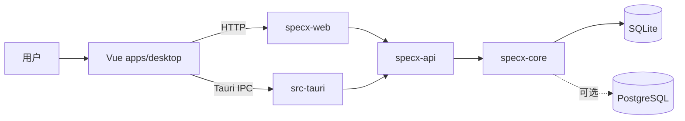

# specX 代码导览

specX 有 Web 和桌面两个 Host，共享同一前端和 API：



## 目录

| 路径 | 责任 |
| --- | --- |
| `apps/desktop/` | Vue 3 + Pinia 共用前端；`components/layout` 组装壳层，`stores` 接资源命令，`lib/backend` 分离 HTTP 与 Tauri IPC |
| `src-tauri/` | 独立桌面壳；本地路径和 IPC 请求转换，业务请求复用 `specx-api` router |
| `crates/specx-types/` | Core、API 和其他消费者共享的资源与工作区数据类型 |
| `crates/specx-formats/` | 与业务无关的内容格式工具；目前 Core 用它规范化 Markdown 换行 |
| `crates/specx-platform/` | 主机进程共用的目录路径、环境原语和数据库 URL 语法 |
| `core/` | 领域规则和 SQLite/PostgreSQL 持久化；向后重导出 `specx-types` 保持 API 兼容 |
| `crates/specx-api/` | API 状态、存储后端门面、授权中间件和资源路由；资源请求/响应与 OpenAPI 当前集中在 `resources.rs` |
| `crates/specx-web/` | Rust Web Host 可执行程序：`auth.rs` 负责服务端密码会话，`main.rs` 组装 API、静态文件与监听器 |
| `deploy/` | Docker 镜像和 Compose 部署 |

## 请求路径

Web Host 在 `/api/specx` 提供统一 API：它先校验 `specx_session`，再注入由会话确定的 tenant/actor 和经成员关系验证的 workspace 上下文，最后由 API 调用 Core。桌面端通过 Tauri command 将相同的请求转换为进程内 router 调用，使用稳定的本地 actor，仍执行同一套授权和持久化逻辑。浏览器存储保留主题、折叠状态、服务显示顺序、面板尺寸与打开的标签；资源事实仍由 API 管理。

前端模块说明见 [apps/desktop/README](../../apps/desktop/README.md)。
界面模块职责、通用交互规则与资源适配边界见
[UI 基础层](../architecture/ui-foundation.md)。
新增或修改路由、DTO、错误状态与 OpenAPI 时，遵循
[API 契约](../architecture/api-contract.md)；中英文文案按
[国际化规范](../architecture/i18n.md)维护。

Web 登录由服务端密码会话保护；桌面身份由本机 Tauri Host 注入，不使用 Web 登录页。两个 Host 都调用 `specx-platform::parse_database_url` 解析 `SPECX_DATABASE_URL`，未设置时 Web 使用 `SPECX_DATA_DIR/specx.sqlite`，桌面使用操作系统应用数据目录下的 `specx.sqlite`。两种 Host 都可显式选择 SQLite 或 PostgreSQL。

## 本地运行

```sh
pnpm install
SPECX_PASSWORD='choose-a-password-at-least-12-chars' pnpm dev:backend
pnpm dev
```

浏览器开发需要同时运行带有 `SPECX_PASSWORD` 的 Web Host；桌面使用 Tauri 本地身份，不需要 Web 登录密码。

桌面开发使用 `pnpm dev:desktop`；构建本机安装包使用 `pnpm build:desktop`。

不设置 `SPECX_DATABASE_URL` 时，数据写入 `SPECX_DATA_DIR/specx.sqlite`。也可以显式使用 `sqlite:///absolute/path/specx.sqlite`，或通过 `postgres://` / `postgresql://` URL 选择 PostgreSQL；两种后端共享同一组 API 和领域操作。Docker 构建通过 `deploy/Dockerfile` 将前端静态文件复制到 Web Host 镜像。

## 修改顺序

新增资源时先在 Core 定义不变量，再在 `specx-api` 增加授权路由，最后在 `apps/desktop` 的 API client 与视图接线。`specx-web` 是 Rust Web Host，`src-tauri` 是独立桌面 Host；Docker 将 `apps/desktop` 静态文件和 Web Host 打进同一个镜像。插件运行时和 AI provider 暂不创建；格式能力保持纯工具，不与前端组件耦合。修改会话或部署配置时，统一使用 `SPECX_` 前缀并更新 `deploy/dockerhub/README.md`。
